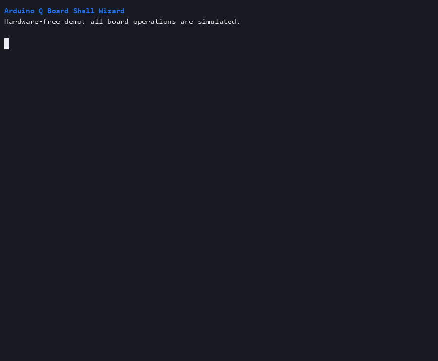

# Arduino Q Board Shell Wizard

Interactive setup and reset for **Arduino Uno Q / Ventuno Q boards running the official Linux image**, following the [App Lab setup flow](https://docs.arduino.cc/software/app-lab/configure/config/). Run the tool from your computer over USB/ADB.

## Run the setup wizard over USB/ADB

Connect the board over USB and run commands from the **repository root**. Keep `board/` and `host/` beside the launchers. ADB must be on your terminal's `PATH`; see the [ADB setup guide](docs/adb.md) if needed.

### Host launchers

On **Windows**, use PowerShell 5.1 or 7:

```powershell
.\board-host.ps1 -Operation setup
.\board-host.ps1 -Operation reset
```

On **Linux or macOS**, use Bash (including macOS's supplied Bash 3.2):

```sh
bash ./board-host.sh setup
bash ./board-host.sh reset
```

With one ready ADB device, the launcher selects it automatically and checks that it is a supported board. It opens the wizard and cleans up uploaded scripts afterward. Before resetting, read the [reset precautions](#reset-setup).

<details>
<summary>Watch a hardware-free setup demo</summary>



Simulated first-use setup; no hardware required.

[Recording (.cast)](docs/media/setup-demo.cast)

</details>

#### Multiple connected devices

Find the board's serial with `adb devices -l`, then add `-Serial YOUR_DEVICE_SERIAL` (PowerShell) or `--serial YOUR_DEVICE_SERIAL` (Bash) to the commands above. See [explicit-selection examples](docs/adb.md#multiple-connected-devices).

Agents and unattended runs **always require an explicit serial**, even with one board. Use the [unattended guide](docs/unattended.md).

### Reuse ADB installed by Arduino

App Lab or the Arduino Q Boards core in the IDE may already provide ADB. See [bundled ADB locations and terminal setup](docs/adb.md#reuse-adb-installed-by-arduino); separate installation and Linux USB-permission instructions are there too.

### Optional SSH key and board alias

After successful interactive setup, the launcher offers SSH key setup; the default is **no**. Use an existing public key (`.pub`), or request the step explicitly:

```powershell
.\board-host.ps1 -Operation setup -SshKey "$HOME\.ssh\id_ed25519.pub"
```

```sh
bash ./board-host.sh setup --ssh-key "$HOME/.ssh/id_ed25519.pub"
```

This needs [OpenSSH on the host](docs/adb.md#optional-openssh-client), enabled Network Mode, and a board reachable over Wi-Fi or Ethernet. Connect with `ssh YOUR_BOARD_NAME`. If `<board-name>.local` does not resolve, add `-SshHost HOST_OR_IP` or `--ssh-host HOST_OR_IP` with the key option.

The step updates host SSH config and restricts the SSH directory/config to your account, removing other-account grants. See [SSH details and failure behavior](docs/technical.md#ssh-client-integration).

### Manual transfer and local-console use

See the [manual guide](docs/manual-transfer.md) for direct board-console use, manual uploads, reset transfers, and cleanup.

### Setup wizard prompts

Blank hostname/keyboard preserves their values; Wi-Fi can be skipped. First use requires a new Linux password. Setting/changing that password enables disabled Network Mode (SSH + Bonjour/Avahi); keeping it prompts about Network Mode when disabled, defaulting to yes. See the [full wizard choices](docs/usage.md#setup-wizard-prompts).

Wi-Fi and Network Mode are separate: enabling SSH/Bonjour does not connect the board to Wi-Fi.

### Linux password rules

New Linux passwords need at least eight characters, must not contain `arduino` (case-insensitive) or backslashes, and must not start/end with whitespace. These rules do **not** apply to Wi-Fi passwords. See [password guidance](docs/usage.md#linux-password-rules).

## Unattended use for agents

Use a private request file and an explicit serial. The [unattended guide](docs/unattended.md) contains the complete request/result contract, protected-file examples, SSH options, and failure handling.

## Add or change Wi-Fi later

On an already provisioned board, rerun setup:

1. Keep hostname and keyboard by leaving them blank.
2. Choose to configure/change Wi-Fi; enter the SSID and the Wi-Fi password at its prompt.
3. Keep the existing Linux password and choose whether to enable Network Mode if asked.

Keep Linux and Wi-Fi passwords separate; enter passwords at prompts, not in command lines. See the [Wi-Fi procedure and checks](docs/usage.md#add-or-change-wi-fi-later).

## Check setup results

Check the requested settings and test SSH from your computer when networking is enabled. See the [board verification commands](docs/usage.md#check-setup-results); USB/ADB access alone does not prove network reachability.

## Reset setup

Use the `reset` launcher command over USB/ADB or a local board console. **Do not reset over SSH.** Close App Lab first, then reopen it afterward.

Reset clears App Lab setup state and preserves apps, files, the Linux password, and SSH keys. It can optionally disable SSH/Bonjour and delete **all saved Wi-Fi profiles and passwords**, including the active connection. Have Wi-Fi credentials available before choosing deletion.

The exact confirmation is `RESET`. This is **not a factory restore**. Read the [full reset choices and precautions](docs/usage.md#reset-setup) before proceeding.

## Troubleshooting and cleanup

Changes already applied remain after a later failure or timeout. Keep USB/ADB access and inspect the actual state before retrying; password changes and resets are never retried automatically. Host transport commands default to 120 seconds; interactive password prompts are not timed out.

Launchers clean up automatically and report cleanup failures. See [troubleshooting](docs/usage.md#troubleshooting-and-cleanup) and [manual cleanup](docs/manual-transfer.md#cleanup). Keep any generated credentials in a private location outside this repository.

## Further documentation

- [ADB and host setup](docs/adb.md)
- [Detailed interactive usage](docs/usage.md)
- [Manual transfer and board-console use](docs/manual-transfer.md)
- [Unattended use for agents](docs/unattended.md)
- [Technical reference and development](docs/technical.md)
- [Agent guide](AGENTS.md)
- [Completed verification record](docs/verification.md)
